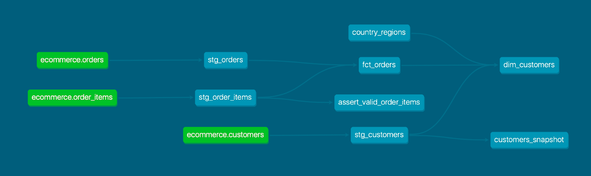

# E-Commerce Analytics Engineering Pipeline

**An automated, tested, and documented ELT analytics pipeline built with dbt Core, PostgreSQL (Supabase), SQL, Jinja, and GitHub Actions.**

This project demonstrates how raw transactional e-commerce data can be transformed into reliable, analytics-ready datasets using modern Analytics Engineering practices.

It covers dimensional data modeling, incremental processing, data quality validation, historical change tracking, source freshness monitoring, automated orchestration, and data lineage.

**Repository:** [github.com/leobaldo97/project_dbt](https://github.com/leobaldo97/project_dbt)

---

## 1. Project Overview

### Business Context

An e-commerce business collects transactional information across three operational datasets:

- **Customers:** Customer profiles and geographic information.
- **Orders:** Customer purchases, transaction dates, and order statuses.
- **Order Items:** Products, quantities, and unit prices associated with each order.

Although these datasets contain useful business information, they are not immediately optimized for analytical reporting.

Analysts would otherwise need to repeatedly join transactional tables, calculate revenue, filter order statuses, and validate data consistency.

### Project Objective

The objective is to build a reusable analytics layer that:

1. Standardizes and validates raw transactional data.
2. Produces consistent order-level and customer-level metrics.
3. Processes new and updated orders incrementally.
4. Tracks historical changes to customer attributes.
5. Detects data quality and freshness issues.
6. Automatically executes transformations and tests.
7. Exposes documented datasets and their dependencies.

### Key Deliverables

| Component | Deliverable |
|---|---|
| Data warehouse | PostgreSQL hosted on Supabase |
| Transformation framework | dbt Core |
| Staging layer | Three SQL views |
| Analytics layer | Incremental fact table and customer dimension |
| Reference data | Country-to-region CSV seed |
| Historical tracking | Customer SCD Type 2 snapshot |
| Data quality | Generic and custom SQL tests |
| Freshness monitoring | Source freshness checks |
| Orchestration | Scheduled GitHub Actions workflow |
| Documentation | dbt Docs and lineage graph |

**Project scope:** This is a demonstration project using a small synthetic dataset. It showcases engineering patterns and operational workflows rather than production-scale data volumes.

---

## 2. Technology Stack

| Technology | Purpose |
|---|---|
| Python 3.11 | Runtime environment |
| dbt Core 1.12.6 | SQL transformations, testing, documentation, snapshots |
| dbt-postgres 1.11.0 | PostgreSQL database adapter |
| PostgreSQL | Relational data storage and analytical processing |
| Supabase | Cloud-hosted PostgreSQL infrastructure |
| SQL | Data modeling, joins, aggregations, and validation |
| Jinja | Reusable macros and conditional incremental logic |
| YAML | dbt configuration, source definitions, and tests |
| Git | Source control |
| GitHub | Repository hosting |
| GitHub Actions | Scheduled pipeline execution and monitoring |

The project uses **dbt Core**, not dbt Cloud. Pipeline scheduling and execution are handled by GitHub Actions.

---

## 3. Architecture and Data Flow

The solution follows an **ELT (Extract, Load, Transform)** architecture.

Raw data is assumed to be available in PostgreSQL before dbt execution. dbt handles the transformation, testing, and documentation layers; the initial extraction and loading of operational data are outside the scope of this repository.

### High-Level Architecture

```text
                    RAW DATA — SUPABASE
                     PostgreSQL / public
                              |
             +----------------+----------------+
             |                |                |
          customers         orders         order_items
             |                |                |
             v                v                v
       stg_customers     stg_orders      stg_order_items
             |                |                |
             |                +--------+-------+
             |                         |
             |                         v
             |                   fct_orders
             |                   INCREMENTAL
             |                         |
             +------------+------------+
                          |
                    country_regions
                       (SEED)
                          |
                          v
                    dim_customers
                        TABLE


Additional capabilities:

stg_customers
      |
      v
customers_snapshot
(SCD Type 2 history)

Sources / Models
      |
      +--> Generic tests
      +--> Custom SQL tests
      +--> Source freshness
      +--> dbt documentation and lineage

GitHub Actions
      |
      +--> dbt debug
      +--> dbt source freshness
      +--> dbt build
```

### Data Lineage

The project uses dbt's `ref()` and `source()` functions to explicitly define dependencies between resources.

These references allow dbt to determine execution order, build the dependency graph, and generate interactive documentation.

**Lineage screenshot:**  

The lineage graph can also be explored interactively by running:

```bash
dbt docs generate
dbt docs serve
```

Then open `http://localhost:8080`.

---

## 4. Repository Structure

```text
project_dbt/
|
|-- .github/
|   `-- workflows/
|       `-- dbt_pipeline.yml
|
|-- ecommerce_analytics/
|   |
|   |-- analyses/
|   |-- macros/
|   |   `-- normalize_status.sql
|   |
|   |-- models/
|   |   |-- sources.yml
|   |   |
|   |   |-- staging/
|   |   |   |-- _staging.yml
|   |   |   |-- stg_customers.sql
|   |   |   |-- stg_orders.sql
|   |   |   `-- stg_order_items.sql
|   |   |
|   |   `-- marts/
|   |       |-- _marts.yml
|   |       |-- fct_orders.sql
|   |       `-- dim_customers.sql
|   |
|   |-- seeds/
|   |   `-- country_regions.csv
|   |
|   |-- snapshots/
|   |   `-- customers_snapshot.yml
|   |
|   |-- tests/
|   |   `-- assert_valid_order_items.sql
|   |
|   `-- dbt_project.yml
|
|-- .gitignore
`-- README.md
```

### Directory Responsibilities

| Directory | Responsibility |
|---|---|
| `models/staging/` | Source standardization and derived fields |
| `models/marts/` | Business-ready analytical models |
| `macros/` | Reusable SQL/Jinja functionality |
| `seeds/` | Version-controlled reference data |
| `snapshots/` | Historical attribute tracking |
| `tests/` | Custom data quality assertions |
| `.github/workflows/` | Automated pipeline configuration |
| `analyses/` | Optional analytical SQL development |

Generated files such as `target/`, `logs/`, and installed packages are excluded from version control.

---

## 5. Source Data

The project expects three existing PostgreSQL tables in the `public` schema.

### 5.1 `public.customers`

Customer master data.

| Column | Description |
|---|---|
| `customer_id` | Unique customer identifier |
| `customer_name` | Customer name |
| `email` | Customer email address |
| `signup_date` | Registration date |
| `country` | Customer country |

### 5.2 `public.orders`

Order-level transactional information.

| Column | Description |
|---|---|
| `order_id` | Unique order identifier |
| `customer_id` | Customer placing the order |
| `order_date` | Date of the order |
| `status` | Raw order status |
| `updated_at` | Timestamp used to identify order modifications |

The example dataset includes statuses such as `completed`, `pending`, and `cancelled`.

### 5.3 `public.order_items`

Product-level information associated with each order.

| Column | Description |
|---|---|
| `order_item_id` | Unique order-item identifier |
| `order_id` | Related order |
| `product_name` | Product description |
| `quantity` | Number of units |
| `unit_price` | Price per unit |
| `updated_at` | Timestamp used to identify item modifications |

### Source Requirements

For the pipeline to work correctly:

- Primary identifiers should be unique and non-null.
- Orders should reference valid customers.
- Order items should reference valid orders.
- Quantities should be positive.
- Unit prices should be non-negative.
- Modification timestamps must be populated and maintained when records change.

**Important:** PostgreSQL column defaults do not automatically update `updated_at` whenever a row changes. The upstream application, ingestion process, or a database trigger must maintain these timestamps.

The repository does not currently include a complete raw-data provisioning or ingestion process. Users deploying the project to a new database must create and populate the required source tables first.

---

## 6. Staging Layer

Staging models provide standardized representations of raw data.

All three staging models are materialized as **PostgreSQL views**.

### `stg_customers`

Exposes customer attributes from the raw customer source.

Its main purpose is to provide a consistent reference for downstream customer analytics and historical tracking.

### `stg_orders`

Standardizes order information and normalizes the order status.

The normalization uses a reusable Jinja macro:

```sql

    LOWER(TRIM({{ column_name }}))

```

Example:

```text
" Completed " -> "completed"
"COMPLETED"   -> "completed"
```

This helps avoid inconsistent grouping or filtering caused by whitespace and capitalization.

### `stg_order_items`

Calculates the monetary value of each order line:

```sql
quantity * unit_price AS line_total
```

For example, an item with quantity `2` and unit price `35` produces a line total of `70`.

The resulting staging view is used by the order-level fact table.

---

## 7. Analytics Marts

The analytics layer contains two business-oriented models.

### 7.1 `fct_orders` — Incremental Fact Table

**Grain:** One row per order.

**Materialization:** `incremental`

**Target:** `analytics.fct_orders`

This model combines order headers and order items to calculate order-level metrics.

| Column | Description |
|---|---|
| `order_id` | Unique order identifier |
| `customer_id` | Associated customer |
| `order_date` | Order date |
| `order_status` | Normalized status |
| `last_modified_at` | Latest modification timestamp across the order and its items |
| `total_items` | Total quantity of items in the order |
| `order_total` | Sum of order-line values |

The order total is calculated as:

```sql
SUM(line_total) AS order_total
```

The total number of items is calculated as:

```sql
SUM(quantity) AS total_items
```

The model includes orders regardless of their status. Consequently, `order_total` is not automatically equivalent to recognized revenue.

Analysts calculating completed-order revenue must explicitly filter for `order_status = 'completed'`.

### 7.2 `dim_customers` — Customer Dimension

**Grain:** One row per customer.

**Materialization:** `table`

**Target:** `analytics.dim_customers`

This model combines customer attributes, geographical reference data, and order metrics.

Its analytical fields include:

- Customer identifier and attributes
- Country and geographic region
- Total completed orders
- Total spending on completed orders
- Average completed-order value

The model uses a left join from customers to order information so customers without completed purchases can remain represented in the analytical output.

Metrics are calculated using completed orders rather than all order statuses.

### Example Analytical Queries

**Completed-order revenue by country**

```sql
SELECT
    c.country,
    COUNT(*) AS completed_orders,
    SUM(o.order_total) AS completed_order_revenue
FROM analytics.fct_orders o
JOIN analytics.dim_customers c
    ON o.customer_id = c.customer_id
WHERE o.order_status = 'completed'
GROUP BY c.country
ORDER BY completed_order_revenue DESC;
```

**Top customers by total spending**

```sql
SELECT
    customer_id,
    total_spent,
    total_orders,
    avg_order_value
FROM analytics.dim_customers
ORDER BY total_spent DESC;
```

**Order-level operational overview**

```sql
SELECT
    order_status,
    COUNT(*) AS order_count,
    SUM(order_total) AS order_value
FROM analytics.fct_orders
GROUP BY order_status
ORDER BY order_count DESC;
```

The final query is an operational breakdown of order value by status, not a recognized-revenue calculation.

---

## 8. Incremental Processing

The fact table uses dbt's incremental materialization to maintain order-level data across repeated pipeline executions.

### Configuration

The incremental model is configured in `dbt_project.yml`:

```yaml
models:
  ecommerce_analytics:
    staging:
      +materialized: view

    marts:
      +materialized: table

      fct_orders:
        +materialized: incremental
        +unique_key: order_id
        +incremental_strategy: delete+insert
```

### How It Works

**Initial execution**

If the destination table does not exist, dbt creates it using the full model query.

**Subsequent executions**

When the incremental table already exists, the model compares source modification timestamps with the timestamp stored for the corresponding order.

An order qualifies for updating when its source modification timestamp is newer than the stored timestamp, or when the order does not yet exist in the target.

The relevant timestamp is calculated using:

```sql
GREATEST(
    MAX(b.updated_at),
    MAX(a.updated_at)
) AS last_modified_at
```

Here:

- `a` refers to staged order items.
- `b` refers to staged orders.

The model uses the `is_incremental()` Jinja condition to apply its incremental filter only during incremental executions.

### Incremental Strategy: `delete+insert`

The unique key is `order_id`.

For rows selected by the incremental model, dbt uses the configured strategy to replace existing target records with recalculated values.

This avoids retaining outdated order totals when an order changes.

### Full Refresh

A full refresh rebuilds the incremental model from the available source data.

```bash
dbt run --full-refresh --select fct_orders+
```

The trailing `+` selects downstream dependent models, including `dim_customers`.

Full refreshes are useful after significant model changes, certain schema changes, or when the incremental target needs to be reconstructed.

### Important Performance and Correctness Considerations

The current incremental implementation is intended to demonstrate change detection and incremental target maintenance.

It has several known limitations:

1. **Source scanning:** Aggregations are calculated before the `HAVING` filter is applied, so the model may still scan and aggregate unchanged source records.
2. **Hard deletes:** Deleted source rows are not automatically propagated to the incremental target.
3. **Timestamp dependency:** Changes may be missed if `updated_at` is not correctly maintained.
4. **Historical timestamps:** The logic assumes that modified records receive a newer modification timestamp.
5. **Concurrency:** Concurrent upstream modifications during execution are not explicitly coordinated.

For larger production datasets, the incremental design could be optimized by identifying changed order IDs before performing the aggregation.

---

## 9. Reference Data and Seeds

The project uses a CSV seed:

```text
seeds/country_regions.csv
```

This dataset maps countries to geographic regions.

Example mappings include:

| Country | Region |
|---|---|
| Italy | Southern Europe |
| Spain | Southern Europe |
| France | Western Europe |
| United Kingdom | Northern Europe |

The seed is referenced by `dim_customers` to enrich customer-level reporting.

To load or refresh seed data independently:

```bash
dbt seed
```

Seeds are version-controlled and are appropriate for small, relatively static reference datasets.

They are not intended to replace a general-purpose ingestion process for large operational tables.

---

## 10. Historical Tracking with dbt Snapshots

The project implements a dbt snapshot to preserve historical changes in customer attributes.

**Snapshot:** `customers_snapshot`

**Strategy:** `check`

**Unique key:** `customer_id`

**Monitored attributes:**

- `email`
- `country`

**Snapshot schema:** `analytics_snapshots`

### Why Snapshots Matter

Standard analytical tables generally represent the latest known state of their records.

However, analysts may need to answer historical questions such as:

- Which country was a customer associated with before an update?
- When did a customer's email address change?
- What was the previous value of a customer attribute?

A snapshot preserves previous versions instead of simply overwriting them.

### SCD Type 2 Behavior

When a monitored attribute changes, dbt can close the previous version and insert a new historical version.

Relevant snapshot metadata includes:

| Field | Purpose |
|---|---|
| `dbt_valid_from` | Beginning of a version's validity period |
| `dbt_valid_to` | End of the validity period, where applicable |
| `dbt_updated_at` | Timestamp associated with the snapshot version |
| `dbt_scd_id` | dbt-generated version identifier |

The project was tested by changing a customer's country and subsequently restoring its original value, verifying that multiple historical versions were preserved.

### Snapshot Execution

```bash
dbt snapshot
```

Snapshots are also included in the automated `dbt build` workflow.

### Snapshot Limitations

The current snapshot tracks only selected customer attributes.

It does not provide historical versions of orders, order statuses, or order items.

Hard-delete tracking is not enabled for this snapshot.

---

## 11. Data Quality and Testing

Data quality is enforced through dbt generic tests and a custom SQL test.

### Generic Tests

The project uses YAML-defined tests to validate:

| Test | Purpose |
|---|---|
| `unique` | Detect duplicate identifiers |
| `not_null` | Ensure mandatory fields are populated |
| `relationships` | Validate references between related datasets |
| `accepted_values` | Validate permitted order statuses |

Generic tests are defined alongside the staging and mart models.

### Custom SQL Test

The file:

```text
tests/assert_valid_order_items.sql
```

checks for invalid order-item values.

The test identifies records with:

```sql
quantity <= 0
OR unit_price < 0
```

In dbt, a singular SQL test passes when its query returns zero rows.

If invalid records are returned, the test fails.

### Running Tests

Run all tests:

```bash
dbt test
```

Run the full project with tests:

```bash
dbt build
```

### Failure Behavior

A failing test is reported in the dbt execution output and can cause the GitHub Actions workflow to fail.

Tests help detect data quality issues, but they do not automatically repair invalid source records.

The source system or data owner remains responsible for correcting underlying data.

---

## 12. Source Freshness Monitoring

The `orders` source includes a freshness configuration based on its `updated_at` timestamp.

The configured thresholds are:

| Threshold | Condition |
|---|---|
| Warning | Latest timestamp older than 1 day |
| Error | Latest timestamp older than 2 days |

Execute the check with:

```bash
dbt source freshness
```

### Important Interpretation

The current configuration uses the latest order modification timestamp as a proxy for source recency.

This is suitable for demonstrating dbt freshness monitoring, but it is not equivalent to monitoring a dedicated ingestion timestamp.

For example, a source may be fully synchronized even if no customer has placed or modified an order recently.

### Behavior in GitHub Actions

Freshness monitoring is implemented as a separate workflow step with:

```yaml
continue-on-error: true
```

This means:

- The freshness result remains visible in GitHub Actions.
- A freshness failure does not prevent `dbt build` from running.
- Build and test failures can still fail the overall workflow.

This decision prevents a static demonstration dataset from blocking all subsequent transformations.

**Production consideration:** This configuration also permits the pipeline to continue after other freshness-step failures, including technical errors. A production deployment should distinguish stale-data conditions from connection failures and other operational incidents.

---

## 13. Local Setup and Execution

### Prerequisites

To execute the project locally, the user needs:

- Python 3.11
- Git
- PostgreSQL connectivity
- Access to a Supabase PostgreSQL instance or compatible PostgreSQL database
- The three expected raw source tables populated in the `public` schema
- Database permissions to create and update dbt-managed objects

The PostgreSQL role must have sufficient permissions for the target analytics and snapshot schemas.

### Step 1 — Clone the Repository

```bash
git clone https://github.com/leobaldo97/project_dbt.git
cd project_dbt
```

### Step 2 — Create a Python Virtual Environment

```bash
python3 -m venv .venv
source .venv/bin/activate
```

On Windows PowerShell:

```powershell
.venv\Scripts\Activate.ps1
```

### Step 3 — Install Dependencies

Install the dbt versions used by this project:

```bash
python -m pip install dbt-core==1.12.6 dbt-postgres==1.11.0
```

### Step 4 — Configure the dbt Profile

Create the dbt profile directory if necessary:

```bash
mkdir -p ~/.dbt
```

Create:

```text
~/.dbt/profiles.yml
```

Example profile:

```yaml
ecommerce_analytics:
  target: dev
  outputs:
    dev:
      type: postgres
      host: "{{ env_var('DBT_HOST') }}"
      user: "{{ env_var('DBT_USER') }}"
      password: "{{ env_var('DBT_PASSWORD') }}"
      port: "{{ env_var('DBT_PORT') | int }}"
      dbname: "{{ env_var('DBT_DBNAME') }}"
      schema: analytics
      threads: 4
      sslmode: require
```

Configure the corresponding environment variables in the local shell or a secure environment manager:

```text
DBT_HOST
DBT_USER
DBT_PASSWORD
DBT_PORT
DBT_DBNAME
```

Use the PostgreSQL connection details provided by the database administrator or Supabase project.

The profile shown above is a template. A deployment may require adjustments to the target schema, database permissions, or SSL settings.

**Never commit database passwords or populated credential files to Git.**

### Step 5 — Enter the dbt Project Directory

```bash
cd ecommerce_analytics
```

All subsequent dbt commands should be executed from this directory.

### Step 6 — Validate the Connection

```bash
dbt debug
```

A successful connection test confirms that dbt can communicate with the configured database.

### Step 7 — Execute the Pipeline

```bash
dbt source freshness
dbt build
```

`dbt build` executes the project's buildable resources, including models, seeds, snapshots, and tests, according to their dependencies.

For a new deployment, verify that the required source tables and target schemas are available before executing the build.

If freshness fails because of static demonstration data, the user can inspect the result and execute `dbt build` separately.

### Step 8 — Explore the Documentation

```bash
dbt docs generate
dbt docs serve
```

Open:

```text
http://localhost:8080
```

The documentation includes model metadata, column information, tests, sources, and the interactive lineage graph.

---

## 14. Automated Pipeline with GitHub Actions

The pipeline is automated using GitHub Actions.

**Workflow file:**

```text
.github/workflows/dbt_pipeline.yml
```

### Execution Triggers

The workflow supports:

**Manual execution**

Using GitHub:

```text
Actions
  -> dbt Analytics Pipeline
  -> Run workflow
```

**Scheduled execution**

```yaml
on:
  workflow_dispatch:
  schedule:
    - cron: "0 6 * * *"
```

The scheduled execution is configured for **06:00 UTC every day**.

This corresponds to:

- 07:00 in Italy/France during standard time
- 08:00 in Italy/France during daylight saving time

GitHub Actions scheduled runs may be delayed depending on platform availability and scheduling conditions.

### Execution Sequence

```text
GitHub Actions Trigger
          |
          v
Checkout Repository
          |
          v
Set Up Python 3.11
          |
          v
Install dbt Core + PostgreSQL Adapter
          |
          v
Configure dbt Profile
          |
          v
Validate Database Connection
       (dbt debug)
          |
          v
Check Source Freshness
  (non-blocking step)
          |
          v
Execute dbt Build
(models, seeds, snapshots, tests)
          |
          v
GitHub Actions Logs and Status
```

### GitHub Secrets

Database credentials are stored using GitHub Actions repository secrets.

| Secret | Purpose |
|---|---|
| `DBT_HOST` | PostgreSQL hostname |
| `DBT_USER` | Database username |
| `DBT_PASSWORD` | Database password |
| `DBT_PORT` | PostgreSQL port |
| `DBT_DBNAME` | Database name |

These secrets are injected into the workflow environment during execution.

The repository does not need to contain the actual database password.

### Monitoring Execution

Navigate to:

**GitHub → Actions → dbt Analytics Pipeline**

Each workflow run provides:

- Execution status
- Start time and duration
- Individual step results
- dbt execution logs
- Error details when a step fails

The pipeline has been successfully executed through GitHub Actions using the configured Supabase connection.

### Operational Considerations

The current workflow:

- Runs in a GitHub-hosted Ubuntu environment.
- Installs dbt during each execution.
- Connects to an existing PostgreSQL database.
- Executes the dbt transformation and validation pipeline.
- Does not require the developer's local computer to remain powered on.

It does not currently provide dedicated alerting integrations, automated source ingestion, or environment-specific deployment approvals.

---

## 15. Common Commands

Run these commands from `ecommerce_analytics/`.

| Command | Purpose |
|---|---|
| `dbt debug` | Validate configuration and database connectivity |
| `dbt compile` | Compile Jinja and SQL without executing models |
| `dbt seed` | Load CSV reference data |
| `dbt run` | Execute models |
| `dbt test` | Run data quality tests |
| `dbt snapshot` | Capture historical changes |
| `dbt build` | Build project resources and run tests |
| `dbt source freshness` | Check configured source freshness |
| `dbt docs generate` | Generate project documentation |
| `dbt docs serve` | Serve documentation locally |

### Useful Model Selection Commands

Run only the incremental fact table:

```bash
dbt run --select fct_orders
```

Run the fact table and its downstream dependencies:

```bash
dbt run --select fct_orders+
```

Run the fact table and its upstream dependencies:

```bash
dbt run --select +fct_orders
```

Rebuild the incremental fact table and update downstream models:

```bash
dbt run --full-refresh --select fct_orders+
```

Run tests associated with the fact table:

```bash
dbt test --select fct_orders
```

---

## 16. Troubleshooting

### Database Connection Failure

**Symptoms:** `dbt debug` fails or PostgreSQL connection errors appear.

Check:

- Database hostname and port
- Username and password
- Database availability
- Network connectivity
- Supabase connection configuration
- SSL settings

### Missing Source Relation

**Symptoms:** PostgreSQL reports that a source table does not exist.

Confirm that `customers`, `orders`, and `order_items` exist in the `public` schema of the configured database.

### Permission Denied

**Symptoms:** dbt cannot create, replace, or update models.

Verify that the database role has the required permissions on the target schemas and relations.

### Incremental Model Does Not Reflect an Update

Check whether:

- The source record was actually modified.
- Its `updated_at` timestamp advanced.
- The order has corresponding order items.
- The modification is detectable by the incremental filter.

A full refresh may be appropriate when the target needs to be rebuilt, but it should not replace investigation of incorrect timestamp maintenance.

### Data Quality Test Failure

Review the failing test's output and investigate the affected source records.

Typical causes include duplicate identifiers, missing references, invalid quantities, or unexpected order statuses.

### Source Freshness Failure

Inspect the latest available `updated_at` value.

A freshness failure may indicate stale data, but in this demonstration dataset it can also occur simply because no new transactions have been generated.

### GitHub Actions Failure

Open the failed run under the repository's **Actions** tab and inspect the specific failing step.

Common causes include invalid repository secrets, database connectivity problems, package installation errors, or failing dbt tests.

---

## 17. Design Decisions and Trade-Offs

| Design Decision | Rationale | Trade-Off |
|---|---|---|
| Staging models as views | Avoid unnecessary storage duplication | Queries are evaluated against source data |
| Customer mart as table | Provide a ready-to-query analytical dataset | Requires rebuilding when upstream data changes |
| Order fact as incremental | Maintain changed orders without replacing the entire target on every run | Current SQL still aggregates source data before filtering |
| `delete+insert` strategy | Replace updated order-level records using a stable key | Does not automatically reconcile hard deletes |
| Customer snapshots | Preserve historical customer attributes | Adds historical storage and processing |
| CSV seed | Version-control small reference mappings | Not suitable for large dynamic reference datasets |
| Generic and singular tests | Enforce reusable and business-specific data quality checks | Detection does not automatically correct source data |
| GitHub Actions | Cloud-based scheduled execution without a dedicated orchestrator | Limited orchestration and observability compared with specialized platforms |
| Non-blocking freshness | Avoid blocking a demonstration pipeline due to static source data | Genuine freshness-related incidents may not fail the workflow |

---

## 18. Known Limitations

This project is intentionally scoped as an Analytics Engineering demonstration.

Current limitations include:

1. **No raw ingestion pipeline:** Source tables must already exist and be populated in PostgreSQL.
2. **Small synthetic dataset:** The implementation has not been benchmarked on production-scale data.
3. **Incremental source scanning:** The fact model does not yet minimize all upstream processing.
4. **No automatic hard-delete reconciliation:** Deleted source records may remain in the incremental target.
5. **Timestamp-based change detection:** Correctness depends on reliable modification timestamps.
6. **Limited snapshot scope:** Only selected customer attributes are historically tracked.
7. **No separate deployment environments:** The current workflow targets a configured database environment.
8. **No dedicated alerting integration:** Operational status is primarily available through GitHub Actions.
9. **No automated database provisioning:** A new user must prepare the required source schema and data.
10. **Non-blocking freshness checks:** Freshness failures are observable but do not stop the build.

These limitations should be considered before adapting the project to a production environment.

---

## 19. Potential Future Improvements

Possible extensions include:

- Add a reproducible source-data generation and loading process.
- Optimize incremental processing by identifying changed order IDs before aggregation.
- Implement explicit hard-delete handling.
- Add historical tracking for order status changes.
- Introduce dedicated ingestion timestamps for more reliable freshness monitoring.
- Add CI validation for pull requests.
- Separate development, staging, and production environments.
- Implement notifications for failed scheduled executions.
- Add a BI reporting layer using Power BI or another visualization platform.
- Introduce larger datasets for performance and scalability testing.

---

## 20. Skills Demonstrated

This project demonstrates practical experience with:

**Analytics Engineering**
- ELT architecture
- Dimensional data modeling
- Fact and dimension tables
- SQL transformations
- Reusable data models

**dbt Core**
- Sources and references
- Materializations
- Incremental models
- Jinja macros
- Seeds
- Snapshots
- Generic and singular tests
- Source freshness
- Documentation and lineage

**Data Quality**
- Referential integrity
- Data validation
- Business-rule testing
- Historical consistency
- Data freshness monitoring

**Data Engineering and DevOps**
- PostgreSQL and Supabase
- Git version control
- GitHub Actions
- Secure credential management
- Scheduled pipeline execution
- Workflow troubleshooting

---

## 21. Conclusion

This project demonstrates an end-to-end Analytics Engineering workflow built around dbt Core and PostgreSQL.

Starting from raw e-commerce data, it produces documented, tested, and reusable analytical models while incorporating incremental processing, historical change tracking, and automated execution.

The result is a maintainable foundation for e-commerce reporting and a practical demonstration of modern Analytics Engineering principles.